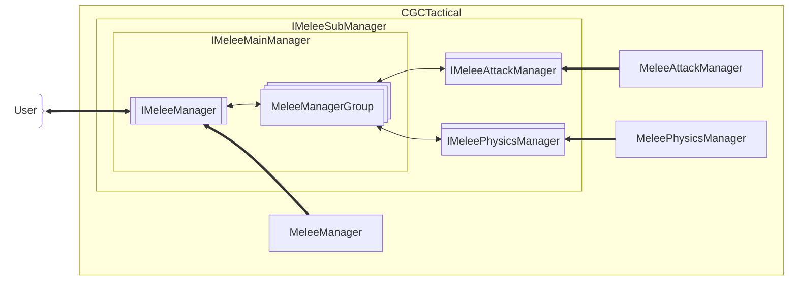

[English](#English)

# 近战框架

近战框架设计为**主管理器**调度各**子管理器**，将各功能拆分至子管理器：

|近战子管理器|对应接口名称|职责简述|
|:--|:--|:--|
|近战管理器（主管理器）|`IMeleeManager`|调度其他近战子管理器|
|近战攻击管理器|`IMeleeAttackManager`||
|近战物理管理器|`IMeleePhysicsManager`||

### 近战子管理器
> 主管理器及子管理器都实现的接口

#### 近战管理器组

主管理器可持有的子管理器的组合，以`managerGroupTag`标识
- 模组内置及默认组合的`managerGroupTag`为 "default"

## 近战管理器
> 前往[近战管理器](./melee-manager.md)

## 近战攻击管理器
> 前往[近战攻击管理器](./attack/melee-attack-manager.md)

## 近战物理管理器
> 前往[近战物理管理器](./physics/melee-physics-manager.md)

# English

The melee framework is designed with a **Main Manager** orchestrating various **Sub-Managers**, splitting functionalities into distinct components:

|Melee Sub-Manager|Corresponding Interface|Responsibility Summary|
|:--|:--|:--|
|Melee Manager (Main)|`IMeleeManager`|Orchestrates other Melee Sub-Managers|
|Melee Attack Manager|`IMeleeAttackManager`||
|Melee Physics Manager|`IMeleePhysicsManager`||

### Melee Sub-Manager
> The common interface implemented by both the Main Manager and all Sub-Managers

#### Melee Manager Group

A combination of sub-managers that the Main Manager can hold, identified by `managerGroupTag`.
- The built-in and default combination's `managerGroupTag` is "default".

## Melee Manager
> Go to [Melee Manager](./melee-manager.md#English)

## Melee Attack Manager
> Go to [Melee Attack Manager](./attack/melee-attack-manager.md#English)

## Melee Physics Manager
> Go to [Melee Physics Manager](./physics/melee-physics-manager.md#English)
