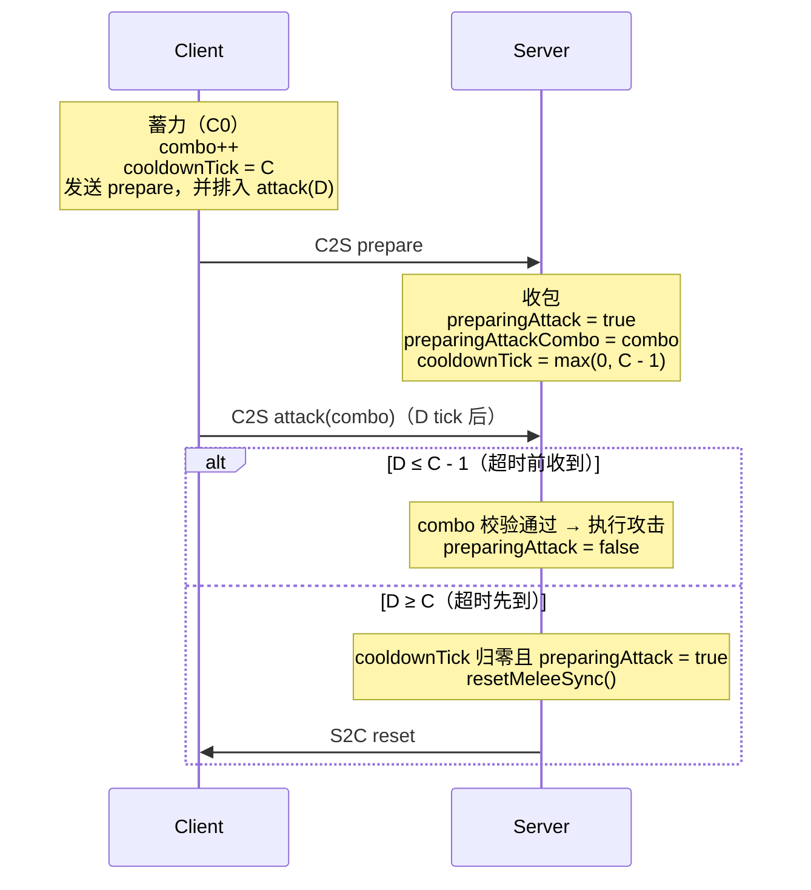

[English](#English)

# 近战网络模型

> 本文只描述时序与不变量，具体实现以文中点名的代码符号为准。代码以本页最后一次提交为准（`git log -1 -- docs/architecture/core/melee/melee-network-model.md`）；符号被重命名、删除或改变语义时，请同步更新本页。

## 状态归属

|状态|端|说明|
|---|---|---|
|`combo`|双端各自维护|客户端与服务端都会在蓄力时自增，靠 `C2SMessageCombatantMelee_attack` 里的 combo 比对来发现分歧|
|`cooldownTick`|双端各自维护|客户端用满值 `C`，服务端用 `C - 1`；每 tick 由实体 tick 递减|
|`preparingAttack` / `preparingAttackCombo`|仅服务端有意义|服务端收到 prepare 时置位，用于校验后续攻击包|
|`clientSchedule`|仅客户端|`delay` 结束后发送攻击包、位移与音效|

## 代码入口

|环节|规则|代码|
|---|---|---|
|客户端蓄力|`cooldownTick == 0` 才可蓄力；`combo++`；`cooldownTick = C`；发送 prepare 并排入 attack|`LocalCombatantMelee#meleeCharge`、`LocalCombatantMelee#chargeAttack`|
|客户端输入时机|输入在 `TickEvent.ClientTickEvent` 的 `END` 阶段处理，晚于实体 tick 里的 `tickCooldown` → 连点周期恰为 C tick|`PrimaryActionKey#tickPrimaryAction`|
|服务端蓄力|拒绝条件：`preparingAttack` 或 `cooldownTick > 0`；通过后 `cooldownTick = max(0, C - 1)`|`LivingCombatantMelee#meleeCharge`、`LivingCombatantMelee#_doCharge`|
|攻击包|携带客户端当时的 combo；服务端先查 `preparingAttack`，再比对 combo|`C2SMessageCombatantMelee_attack#handle`|
|蓄力结束|收到合法攻击包即 `preparingAttack = false`，与是否命中/打空无关|`LivingCombatantMelee#meleeAttack`|
|combo 不匹配|强制 `resetMeleeSync()` 并 `return`，不执行本次攻击|`LivingCombatantMelee#meleeAttack`|
|超时兜底|服务端 `cooldownTick` 归零时若仍 `preparingAttack`，强制重置并推送 reset|`LivingCombatantCooldown#tickCooldown`|
|客户端同步|收到 reset 后清空本地冷却与 combo|`_S2CMessageCombatantMelee_reset#handle`|
|每 tick 驱动|先 `tickCooldown`，再 `tickScheduler`（客户端延迟攻击包）|`LivingEntityMixin#cgctactical$defaultLivingCombatantTick`|
|数值来源|`C` = 攻击数据的 `cooldown`，`D` = `delay`；默认 `C = 20`、`D = 0`|`MeleeDataAccessor#getMeleeCooldown`、`MeleeDataAccessor#getMeleeDelay`、`_MeleeAttackInfo`|

## 时序

记 `C = cooldown`，`D = delay`，服务端在 tick `S` 前的收包窗口处理 prepare。

1. 客户端在 `C0` 蓄力：本地 `cooldownTick = C`，combo 自增，发送 prepare，并把攻击包排到 `C0 + D`。
2. 服务端处理 prepare：若当前没有蓄力且冷却为 0，则 `preparingAttack = true`、`cooldownTick = max(0, C - 1)`。这个 `-1` 用于补偿「prepare 在两个 tick 之间被处理」的偏移。
3. 服务端超时点 = `S + (C - 1)`。客户端下一次合法蓄力在 `C0 + C`，其 prepare 约在服务端 `S + C` 到达 —— 超时恰好比下一次蓄力早 1 tick。
4. 攻击包在 `C0 + D` 发出。prepare 与 attack 都是 C2S，固定延迟在两者的相对时序里抵消；决定成败的是 `D` 与两包之间的抖动。

## 数值边界

|`C` 与 `D` 的关系|结果|安全余量 `C - 1 - D`|
|---|---|---|
|`D = 0`（默认）|prepare 与 attack 同一 tick 发出，正常|`C - 1`|
|`D ≤ C - 2`|正常|≥ 1 tick|
|`D = C - 1`|硬边界：攻击包与超时落在同一 tick。收包窗口在实体 tick 之前，所以无抖动时仍能通过；抖动 1 tick 即被丢弃|0|
|`D ≥ C`|故障：超时先触发 → 攻击包被丢弃并强制重置。`D > C` 时客户端下一段蓄力早于上一段攻击包发出，必然 combo mismatch|负|
|`C ≤ 1`|服务端 `cooldownTick` 在蓄力后即为 0，`tickCooldown` 直接返回，没有超时兜底；攻击包一旦丢失，`preparingAttack` 会一直为 true（直到切换物品触发 `resetProperty`），且没有任何攻速限制|—|

默认数据 `C = 20`、`D = 0`，余量 19 tick，正常情况下超时兜底不应触发。

## 数值填写参考

> `C = cooldown`，`D = delay`，单位 tick（1 tick ≈ 50 ms）。两条约束相互独立：一条保证逻辑成立，一条保证弱网下不出问题。

1. 逻辑硬约束：`D ≤ C - 1`。攻击包必须早于下一次蓄力发出，否则下一段 prepare 会先到，combo 必然错位。
2. 网络安全约束：`C - 1 - D ≥ J`，即 `C ≥ D + 1 + J`。`J` 是 prepare 与 attack 两个包之间的抖动（tick）。单向延迟在两者的相对时序里抵消，不进入不等式；进入不等式的是抖动。

实际填写时按 `C ≥ D + 2 + J` 留 1 tick 富余：

|网络状况|`J`（tick）|推荐 `C`|
|---|---|---|
|本机 / 局域网|1|`C ≥ D + 3`|
|公共服务器（稳定）|2|`C ≥ D + 4`|
|公共服务器（抖动明显）|3~4|`C ≥ D + 5~6`|
|移动网络 / 弱网|≥ 6|`C ≥ D + 8`|

- 默认 `D = 0`、`C = 20`，余量 19 tick，属于很保守的配置。
- 快攻（如 `C = 6`）保持 `D = 0` 最稳；`D = 4` 余量只剩 1 tick，等同硬边界；`D = 5` 进入故障区间。
- `C` 同时是连点间隔（攻速），`D` 是攻击包相对输入的延迟（前摇）。需要长前摇时优先加大 `C`，不要把 `D` 推到接近 `C`。
- `C ≤ 1` 时超时兜底失效；需要兜底至少 `C ≥ 2`，实际建议 ≥ 3。
- 单向延迟不参与安全判定，但会让服务端伤害生效时间整体后移 `D + L`，并让重置包更晚到客户端；高延迟环境优先选 `D = 0`。

## 延迟与抖动

- 固定延迟会抵消，吃余量的是抖动：1 tick ≈ 50 ms。余量只有几 tick 时，弱网就可能把攻击包推到超时之后。
- 不要给超时再加 1 tick：那会让重置与下一次 prepare 落在同一 tick，prepare 被 `preparingAttack` 拒绝，而客户端 combo 已自增 → 下一次必然 mismatch。重置必须早于下一次合法蓄力。
- reset 包需要 RTT 才能让客户端同步。只要发生一次超时，客户端通常会先按旧 combo 发出下一次蓄力，因此任何超时都会损失 1~2 个攻击周期，即使之后自动恢复。

## 修改本模型时的自检

- [ ] 是否仍满足 `D ≤ C - 2`（至少给 1 tick 抖动预算）。
- [ ] 服务端是否仍然用 `C - 1`，保持「超时早于下一次蓄力 1 tick」。
- [ ] 蓄力结束是否仍只取决于「收到合法攻击包」，不依赖命中结果（打空/无目标也必须结束）。
- [ ] combo 不匹配分支是否在重置后 `return`，不再执行本次攻击。
- [ ] 客户端与服务端 combo 是否仍然各自自增、通过攻击包比对，而不是依赖额外的同步包。

# English

> This page describes the timing and invariants only; the code symbols named here are authoritative. The code is taken as of the last commit that touched this page (`git log -1 -- docs/architecture/core/melee/melee-network-model.md`); update this page when those symbols are renamed, removed, or change semantics.

## State ownership

|State|Side|Notes|
|---|---|---|
|`combo`|Both, independently|Incremented on charge on each side; divergence is detected by comparing the combo carried in `C2SMessageCombatantMelee_attack`|
|`cooldownTick`|Both, independently|Client uses the full `C`; server uses `C - 1`. Decremented in the entity tick|
|`preparingAttack` / `preparingAttackCombo`|Server only|Set when the server accepts a prepare; used to validate the following attack|
|`clientSchedule`|Client only|Sends the attack packet, movement and sound after `delay`|

## Code entry points

|Step|Rule|Code|
|---|---|---|
|Client charge|Requires `cooldownTick == 0`; `combo++`; `cooldownTick = C`; sends prepare and schedules the attack|`LocalCombatantMelee#meleeCharge`, `LocalCombatantMelee#chargeAttack`|
|Client input timing|Input is handled in `TickEvent.ClientTickEvent` `END`, after `tickCooldown` in the entity tick → the repeat cycle is exactly C ticks|`PrimaryActionKey#tickPrimaryAction`|
|Server charge|Rejected when `preparingAttack` or `cooldownTick > 0`; otherwise `cooldownTick = max(0, C - 1)`|`LivingCombatantMelee#meleeCharge`, `LivingCombatantMelee#_doCharge`|
|Attack packet|Carries the client's combo; the server checks `preparingAttack` first, then the combo|`C2SMessageCombatantMelee_attack#handle`|
|Charge ends|A valid attack packet sets `preparingAttack = false` regardless of hit/miss/empty targets|`LivingCombatantMelee#meleeAttack`|
|Combo mismatch|Forced `resetMeleeSync()` and `return`; the attack is not executed|`LivingCombatantMelee#meleeAttack`|
|Timeout safety net|When the server's `cooldownTick` reaches 0 while `preparingAttack` is still set, force a reset and push it to the client|`LivingCombatantCooldown#tickCooldown`|
|Client resync|A received reset clears the local cooldown and combo|`_S2CMessageCombatantMelee_reset#handle`|
|Per-tick driver|`tickCooldown` runs before `tickScheduler` (which sends delayed client attacks)|`LivingEntityMixin#cgctactical$defaultLivingCombatantTick`|
|Value source|`C` = attack data `cooldown`, `D` = `delay`; defaults `C = 20`, `D = 0`|`MeleeDataAccessor#getMeleeCooldown`, `MeleeDataAccessor#getMeleeDelay`, `_MeleeAttackInfo`|

## Timing

With `C = cooldown`, `D = delay`, and the server processing the prepare in the packet window before tick `S`:

1. The client charges at `C0`: local `cooldownTick = C`, combo increments, prepare is sent, and the attack is scheduled for `C0 + D`.
2. The server processes the prepare: if not already charging and the cooldown is 0, it sets `preparingAttack = true` and `cooldownTick = max(0, C - 1)`. The `-1` compensates for the prepare being processed between two ticks.
3. The server timeout is `S + (C - 1)`. The client's next legal charge is at `C0 + C`, whose prepare arrives at the server around `S + C` — the timeout lands exactly one tick before the next charge.
4. The attack is sent at `C0 + D`. Both prepare and attack are C2S, so constant latency cancels between them; what matters is `D` and the jitter between the two packets.

## Numeric boundaries

|Relation|Outcome|Margin `C - 1 - D`|
|---|---|---|
|`D = 0` (default)|prepare and attack are sent in the same tick; fine|`C - 1`|
|`D ≤ C - 2`|fine|≥ 1 tick|
|`D = C - 1`|Hard boundary: the attack and the timeout land in the same tick. The packet window runs before the entity tick, so it passes without jitter; one tick of jitter drops it|0|
|`D ≥ C`|Broken: the timeout fires first, the attack is dropped and the state is reset. With `D > C` the next charge is even sent before the previous attack, guaranteeing a combo mismatch|negative|
|`C ≤ 1`|The server's `cooldownTick` is 0 right after charging, so `tickCooldown` returns early: there is no timeout safety net; a lost attack leaves `preparingAttack = true` until an item switch triggers `resetProperty`, and there is no attack-rate limit at all|—|

With the defaults `C = 20`, `D = 0` the margin is 19 ticks; the timeout should never fire in normal play.

## Value selection guide

> `C = cooldown`, `D = delay`, in ticks (1 tick ≈ 50 ms). Two independent constraints: one keeps the logic correct, the other keeps it working on a bad connection.

1. Hard logic constraint: `D ≤ C - 1`. The attack must be sent before the next charge; otherwise the next prepare arrives first and the combo will mismatch.
2. Network safety constraint: `C - 1 - D ≥ J`, i.e. `C ≥ D + 1 + J`. `J` is the jitter between the prepare and attack packets (ticks). One-way latency cancels between the two packets and does not enter the inequality; jitter does.

In practice, use `C ≥ D + 2 + J` to keep one tick of slack:

|Network|`J` (ticks)|Recommended `C`|
|---|---|---|
|Local / LAN|1|`C ≥ D + 3`|
|Public server (stable)|2|`C ≥ D + 4`|
|Public server (jittery)|3~4|`C ≥ D + 5~6`|
|Mobile / poor network|≥ 6|`C ≥ D + 8`|

- Defaults `D = 0`, `C = 20` leave 19 ticks — very conservative.
- For fast attacks (e.g. `C = 6`), keep `D = 0`; `D = 4` leaves only one tick (the hard boundary), and `D = 5` is broken.
- `C` is also the repeat interval (attack rate), and `D` is the attack packet delay relative to input (wind-up). For a long wind-up, raise `C`; do not push `D` close to `C`.
- When `C ≤ 1` the timeout safety net does not exist; use at least `C ≥ 2`, preferably 3.
- One-way latency does not affect the safety check, but it shifts server-side damage by `D + L` and delays the reset packet; prefer `D = 0` on high-latency servers.

## Latency and jitter

- Constant latency cancels; jitter consumes the margin: 1 tick ≈ 50 ms. With only a few ticks of margin, a poor connection can push the attack past the timeout.
- Do not add another tick to the timeout: it would make the reset land in the same tick as the next prepare, which the server rejects while the client has already incremented its combo — guaranteeing a mismatch. The reset must happen before the next legal charge.
- The reset packet needs an RTT to resync the client. Whenever a timeout happens, the client usually issues its next charge with the stale combo first, so every timeout costs 1–2 attack cycles, even though it recovers afterwards.

## Self-check when changing this model

- [ ] `D ≤ C - 2` still holds (at least one tick of jitter budget).
- [ ] The server still uses `C - 1`, keeping the timeout one tick before the next charge.
- [ ] Ending the charge still depends only on receiving a valid attack packet, not on the hit result (a miss or empty target list must also end it).
- [ ] The combo-mismatch branch resets and then `return`s without executing the attack.
- [ ] Both sides still increment their own combo and reconcile via the attack packet, rather than relying on an extra sync packet.
